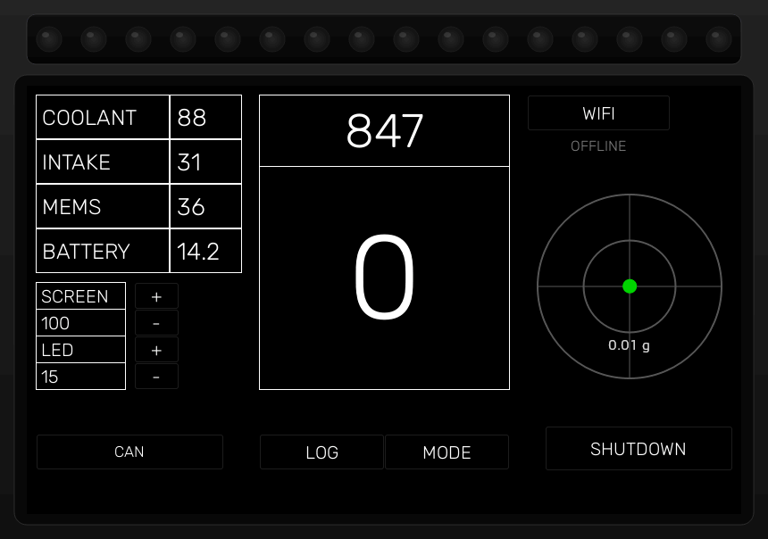

# digidash

A touchscreen car dashboard for the Raspberry Pi. It reads live data from an OBD-II UART adapter and drives a WS2812B LED shift light.



## Features

- RPM, speed, coolant and intake temperature, and battery voltage over OBD-II
- LED shift light with configurable RPM thresholds
- G-force gauge with peak hold, using the adapter's accelerometer (if present)
- CSV logging of readings
- Day and night themes, with screen and LED brightness controls
- On-screen WiFi toggle through NetworkManager
- Built-in CAN bus sniffer for exploring your car's messages

## Hardware

- Raspberry Pi
- Raspberry Pi 7" touchscreen (800×480)
- OBD-II UART adapter, connected to the Pi's serial pins. The original build used a Freematics adapter. The accelerometer and CAN sniffer rely on Freematics-specific commands.
- WS2812B LED strip (16 LEDs by default)

In the original build, the Pi and the screen are powered by the adapter through the OBD port.

## Setup

The original build ran on Raspberry Pi OS Lite. You will need roughly these steps, but details depend on your hardware and OS version:

1. Enable the hardware serial port and disable the serial login console (`raspi-config` → Interface Options → Serial Port).
2. Install Python 3 and the packages in `requirements.txt` (PyQt5, pyserial, rpi_ws281x).
3. Install the [Rubik](https://fonts.google.com/specimen/Rubik) font, which the UI uses.
4. Configure a way to show a Qt app without a desktop, for example a minimal X server or Qt's `eglfs` platform.
5. Optionally, set `DIGIDASH_WIFI_SSID` and `DIGIDASH_WIFI_PASSWORD` in the environment for the WiFi button.

Then run the dashboard. The LED library needs root access:

```bash
sudo -E python3 main_dashboard.py
```

The dashboard writes `dash.log` and a `logs/` folder inside the project directory.

## Configuration

All settings are in [`modules/config.py`](modules/config.py): the serial port, polled PIDs, shift-light thresholds and colours, accelerometer orientation, backlight path and CAN sniffer presets.

The screen layout is in `digidash.ui`, which you can edit with Qt Designer.

## Third-party components

| Component | License |
|---|---|
| [PyQt5](https://www.riverbankcomputing.com/software/pyqt/) | GPL v3 |
| [pyserial](https://github.com/pyserial/pyserial) | BSD-3-Clause |
| [rpi_ws281x](https://github.com/rpi-ws281x/rpi-ws281x-python) | BSD-2-Clause |
| [Rubik font](https://fonts.google.com/specimen/Rubik) (not bundled) | SIL Open Font License 1.1 |

## License

[GPL-3.0](LICENSE)

## Disclaimer

This is a hobby project, provided as is. Do not use the screen while driving. Connecting devices to your car's OBD port is at your own risk.
